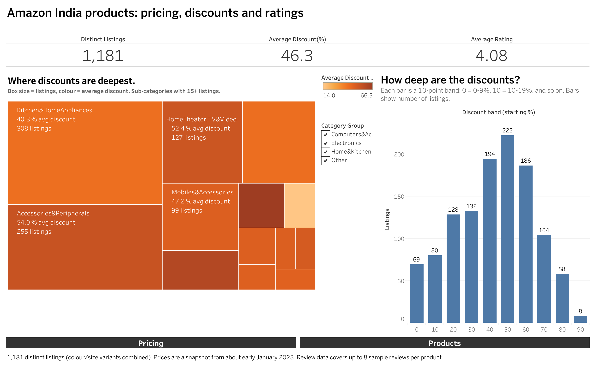
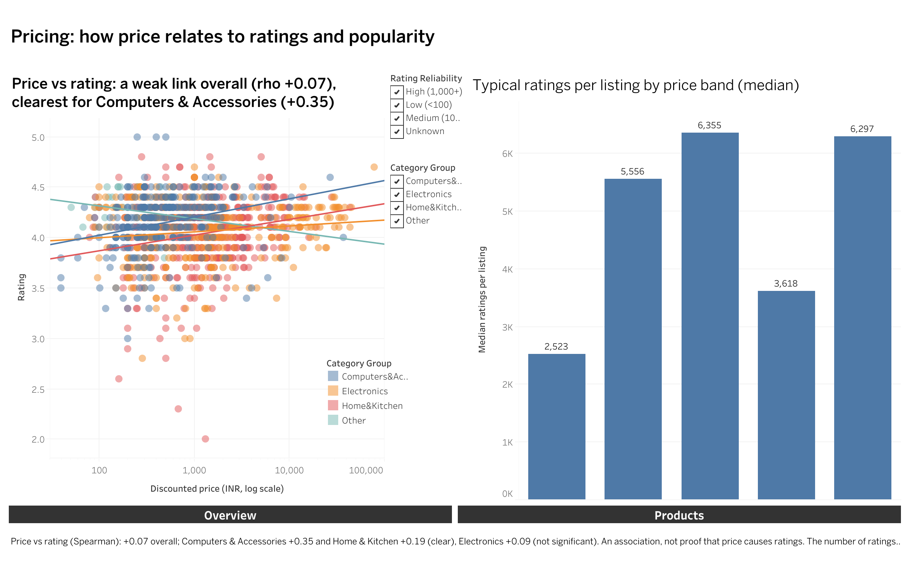
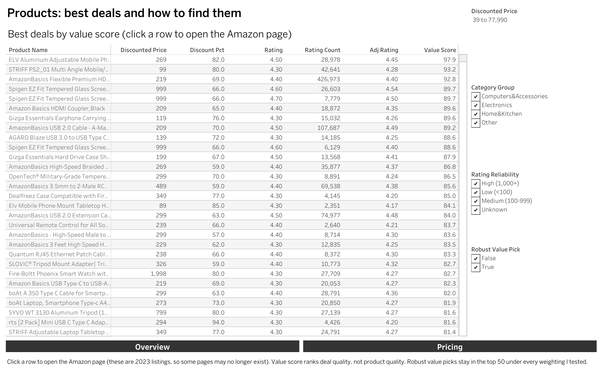

# Amazon India Products: Do Discounts Really Drive Customer Satisfaction?

An end-to-end analysis of 1,181 distinct Amazon India product listings (electronics, computer accessories, and home and kitchen): how discounts, prices and ratings relate, which ratings can be trusted, and what reviewers complain about. The project goes from a messy scraped spreadsheet to a cleaned database, statistical tests, an Excel summary and a three-page interactive dashboard.

**Live dashboard:** [Tableau Public](https://public.tableau.com/app/profile/soumil.jain/viz/AmazonIndiaProductsPricingDiscountandRatingAnalysis/Overview)



| Pricing | Products |
|---|---|
|  |  |

---

## Questions and answers

**1. Do heavier discounts go with better or worse ratings?**
Slightly worse, and the link is weak but consistent. Average rating falls with every discount band:

| Discount band | Listings | Average rating |
|---|---|---|
| 0 to 19% | 149 | 4.17 |
| 20 to 39% | 260 | 4.13 |
| 40 to 59% | 416 | 4.07 |
| 60 to 79% | 290 | 4.04 |
| 80% or more | 66 | 4.00 |

Spearman correlation between discount and rating is -0.16 (p < 0.001). Discount explains only about 3% of the variation in rating ranks, so this is an association, not proof that discounts cause lower ratings.

- **No Simpson's paradox.** The relationship is negative inside every category group (-0.17 Computers and Accessories, -0.19 Electronics, -0.22 Home and Kitchen), so it is not a side effect of category mix.
- **It does not hold everywhere.** Within price bands it is clear under ₹500 (-0.20) and at ₹1,000 to ₹2,500 (-0.22), but not detectable at ₹500 to ₹1,000, ₹2,500 to ₹10,000 or above ₹10,000.
- **It does not depend on my deduplication.** The result is -0.150 on all 1,350 rated products and -0.163 on the 1,180 distinct rated listings.

**2. Which categories discount the most?**
Discounting depends heavily on product type. By sub-category (13 with 15+ listings), the average discount runs from about 14% for office products to about 66% for wearables, with headphones at 60% and accessories and peripherals at 54%. By broad category group, Electronics (52.0%) and Computers and Accessories (51.8%) discount far more than Home and Kitchen (40.1%).

**3. Which price range gets the most customer ratings (a proxy for sales)?**
Averages are misleading here because a few blockbusters dominate (one HDMI cable has 426,973 ratings), so I use medians:

| Price band | Listings | Median ratings per listing |
|---|---|---|
| Under ₹500 | 443 | 2,523 |
| ₹500 to 1,000 | 221 | 5,556 |
| ₹1,000 to 2,500 | 279 | 6,355 |
| ₹2,500 to 10,000 | 172 | 3,618 |
| ₹10,000+ | 66 | 6,297 |

Listings under ₹500 typically get the fewest ratings. Listings at ₹500 to ₹2,500 get roughly twice as many, and there is a dip at ₹2,500 to ₹10,000.

**4. Does price predict rating?**
Barely. Overall Spearman is +0.07, but it hides a category difference: +0.35 for Computers and Accessories and +0.19 for Home and Kitchen, against a non-significant +0.09 for Electronics.

**5. Which ratings are unreliable?**
Eleven listings rated 4.5 or higher have fewer than 100 ratings (one 5.0 rating rests on 5 ratings). A raw rating cannot separate those from a 4.5 backed by 20,000 ratings, so I built a **trust-adjusted rating** (Bayesian average) that pulls low-volume ratings toward the overall mean. Those 11 listings drop to about 4.09, while a well-supported rating such as 4.8 from 53,803 ratings barely moves.

**6. What do reviewers complain about in low-rated products?**
Review text can only be analysed at title level (see Limitations). Comparing the lowest-rated listings (rating 3.8 or below) with the highest-rated (4.4 or above):

- **About 3x as many negative titles** in low-rated products (14.1% against 4.6%).
- **At listing level**, average title sentiment correlates with rating at +0.32 (783 listings with 3 or more titled reviews).
- **Themes** appear roughly 3 to 7 times as often in low-rated products: value for money ("waste of money"), poor quality, not working or durability, and lukewarm wording ("ok", "average"). Each problem theme is still only 1 to 2% of titles, so most reviewers of even low-rated products are positive.
- **A hypothesis, not a finding:** phrases such as "good in this price range" appear about 3x as often in low-rated products (14 against 4 titles), which may mean buyers excuse flaws because of the price.

**7. Which products are the best deals?**
A 0 to 100 **value score** combines the trust-adjusted rating (50%), the discount (30%) and the price relative to similar products (20%). It ranks *deal quality*, not product quality. Because the weights are a judgment call, I tested four alternatives (rank correlation 0.88 to 0.96) and report **24 robust value picks**, listings that stay in the top 50 under all five weightings. They are mostly cheap, heavily discounted everyday accessories (phone stands, HDMI and USB cables, screen protectors).

---

## Data and cleaning

The raw file has 1,465 rows and 16 columns, one scrape row per product with up to 8 reviews packed into comma-separated cells.

| Stage | Count | What changed |
|---|---|---|
| Raw rows | 1,465 | |
| Unique product IDs | 1,351 | 114 repeat scrapes of the same product removed (kept the row with the highest rating count) |
| Distinct listings | 1,181 | Colour and size variants share one review pool; 97 variant groups, kept in the data and flagged |
| Unique reviews | 9,265 | 10,598 product-to-review links, stored in a bridge table |

**Key decisions** (the full list is in `data/clean/decision_log.md`):

- **Repeated product IDs** were the same product scraped on different pages, not different products. One product with conflicting actual prices (999 against 1,899) kept the majority value.
- **Discount accuracy was verified.** The stated discount matches the value recomputed from prices (largest gap 0.5 points, rounding only). The check cannot tell whether the listed "actual price" was inflated to begin with.
- **Missing values were flagged, not filled.** One rating contained `|` and two products had no rating count; they were left null and excluded from the adjusted rating.
- **Only the ID columns could be split reliably.** Review titles matched the review count for about 67% of reviews and review content for about 13%, so content stays at product level and titles are used only where counts match.
- **Shared reviews across variants** are why the review table has 9,265 rows and not 10,598. Rating and review-count analyses use one row per listing (`is_primary_listing`) so the same customers are not counted several times.
- **Six tiny main categories** (38 listings between them) are combined as "Other" for comparisons.
- **Garbled characters** (a text-encoding issue in the raw file) were repaired in product names, descriptions and review titles.

## Methods

- **Trust-adjusted rating:** `(v / (v + m)) * rating + (m / (v + m)) * C`, with C the mean rating (4.09) and m the median rating count (3,763). Tested for m from 100 to 10,000: the overall ordering is stable (rank correlation 0.96 or higher), but top-20 membership is not, so I use it to flag unreliable ratings, not to publish exact rankings.
- **Statistics:** Spearman correlation and Kruskal-Wallis tests, because prices are heavily skewed (mean ₹3,305 against a median of ₹899). Ratings differ across category groups (Kruskal-Wallis p < 0.001), but the gaps are small.
- **Price-premium flag:** 24 listings priced at 2x or more above their category median (categories with 10+ listings). It is a screen for manual review, not a verdict, because categories can mix product types and certified products legitimately cost more.
- **Text analysis:** VADER sentiment on review titles, plus transparent keyword rules for complaint themes. VADER is English-only and rough, and 25 Hindi titles score neutral.

## Tools

| Tool | Used for |
|---|---|
| Python (pandas, NumPy, SciPy, Seaborn, VADER) | Cleaning, feature engineering, statistical tests, charts, text analysis |
| MySQL 8 | Three-table schema (products, reviews, a many-to-many bridge); GROUP BY, window functions, CTEs and joins |
| Excel | Pivot tables cross-checked against the SQL results, conditional formatting, one-page summary |
| Tableau Public | Three-page interactive dashboard (Overview, Pricing, Products) |

## Repository structure

```
.
├── README.md
├── requirements.txt
├── data/
│   └── clean/          products_clean.csv, product_reviews.csv, decision_log.md, analysis workbook
├── docs/               executive_summary.pdf
├── excel/              amazon_pricing_analysis.xlsx
├── notebooks/          cleaning_and_analysis.ipynb
├── sql/                schema.sql, analysis_queries.sql
├── tableau/            packaged workbook (.twbx)
└── visuals/            charts and dashboard images
```

`reviews_clean.csv` is not committed because it contains reviewer names and IDs. The notebook regenerates it.

## How to reproduce

1. Create the environment: `python3 -m venv .venv`, then `source .venv/bin/activate`, then `pip install -r requirements.txt`.
2. Place the raw files in `data/raw/`: amazon.csv (the original download) and amazon_dataset_temp_clean.xlsx (the Excel copy the notebook reads).
3. Run the notebook top to bottom. It writes the clean files to `data/clean/`.
4. In MySQL 8 or later, run `sql/schema.sql`, load the three tables from the notebook's load cell, then run `sql/analysis_queries.sql`.

## Limitations

- **Prices are a snapshot** that appears to date from early January 2023 (inferred from timestamps in the product links), so current prices will differ.
- **Rating count is only a proxy for sales.** It measures how many people rated the product, not how many bought it.
- **Reviews are a sample.** The file holds at most 8 reviews per product, while the rating count shows the true volume, and there is no star rating per individual review. That is why the text analysis compares low-rated and high-rated *products* instead of individual reviews.
- **Associations, not causes.** None of the discount or price relationships proves that one drives the other.
- **Value score ranks deals, not quality.** A premium phone can score low simply because it is expensive and barely discounted.

## Data source

Amazon Sales Dataset (Kaggle), obtained through the notebook [Amazon Sales Dataset EDA](https://www.kaggle.com/code/mehakiftikhar/amazon-sales-dataset-eda/notebook). The data appears to have been scraped from Amazon India in January 2023. Licence: see the dataset's Kaggle page. The raw files are not included in this repository.

## About

Soumil Jain, BTech in Information Technology. I am looking for entry-level data analyst roles.

[LinkedIn](https://in.linkedin.com/in/soumil-jain0774) | [GitHub](https://github.com/soumil-714)